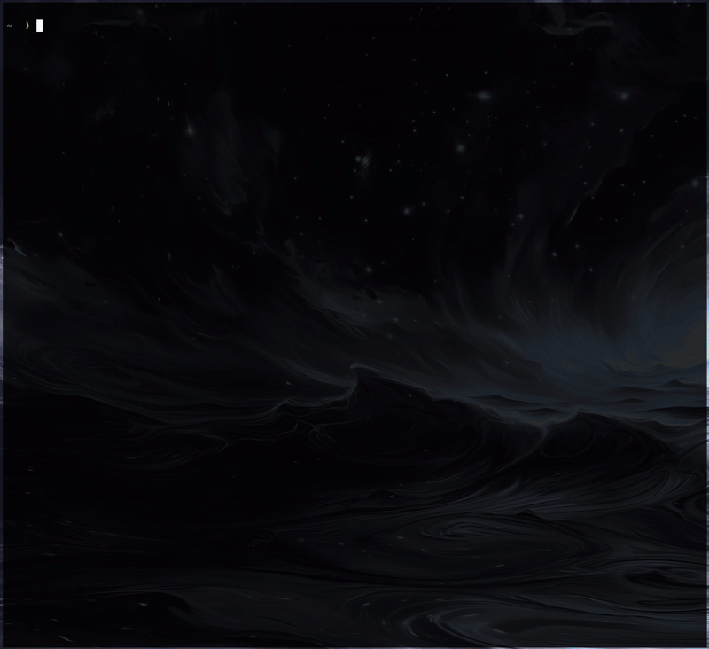

---

<div align="center"></div>

---

<div align="center">single-file terminal emulator (library) written in C11.</div>

## Features

- **Lightweight** - as low as 60KB binary size with <10MB RAM usage
- **Built-in Multiplexer** - tmux-like tabs, status bar, prefix keybindings, thumbnail previews, and tab reordering
- **Declarative & Modular** - clean runtime `sfte_config` struct paired with compile-time zero-overhead macro toggles
- **One-size-fits-all** - can be used on everything from microcontrollers to daily-driven machines
- ***(Almost)* dependency-free** - dependencies are minimized with crucial ones being inlined
- **Capable** - supports Kitty graphics, Kitty keyboard protocol, Sixel images, True Color, font fallbacks, styled and colored underlines
- **Smooth** - dynamic font atlas cache eviction, smooth scrolling with accumulation, buffer transitions, and cursor trail

## Platforms

Currently, **sfte** only supports Wayland as a native experience.
That being said, custom backends are supported, allowing it to be ported to anything as easily as possible.

Planned supported platforms are:

- macOS,
- X11 for legacy support,
- [sokol](https://github.com/floooh/sokol) for easy game engine embedding.

## Installing

### Prerequisites

- Any C compiler supporting C11+ standard
- Development headers for `wayland-client` and `xkbcommon`

### Getting started

1. Clone the repository.

```sh
git clone https://github.com/nihiL7331/sfte.git --depth=1
cd sfte
```

2. Compile the build binary (nob).

```sh
cc nob.c -o nob
```

3. Run the build binary with the `install` argument.

```sh
./nob install
```

## Customization

**sfte** combines compile-time optimization with declarative runtime configuration.

1. **Compile-time macros** (e.g. `#define SFTE_MUX 1`, `#define SFTE_FONT_BOLD`):
   Enable or disable features before including the header, allowing the compiler to strip unused code and maximize performance.
2. **Runtime `sfte_config`**:
   Visual and behavioral settings—such as font paths, colors, window padding, multiplexer bar format, and scrollback limits—are cleanly configured via a `static const sfte_config cfg` in `config.c` and passed to `sfte_wayland_init(&cfg)`.

When you build the project for the first time, a default `config.c` is generated from `config.def.c`. A complete description of all options and macros can be found directly inside `src/config.h` (or in `sfte.h`).

Whenever changes are made to `config.c`, recompile using:

```sh
./nob install
```

### Why handle customization this way?

Zero-cost abstractions: compile-time macros eliminate unused subsystems completely, while the declarative `sfte_config` struct avoids complex config file parsing at runtime.

It also fits the single-file premise of this project: all that is needed to compile and run **sfte** are the prerequisites, the `nob` build tool, `sfte.h`, and `config.c`. Everything fits cleanly in a dotfiles repository without bloated dependencies.

## Dependencies

**sfte** tries to use as few dependencies as possible.
There are still a couple of mandatory ones, which were hard to get rid of, hence they got inlined.

- [`stb_truetype.h`](https://github.com/nothings/stb/blob/master/stb_truetype.h)
- [`stb_image.h`](https://github.com/nothings/stb/blob/master/stb_image.h)
- [`tiny-regex-c`](https://github.com/kokke/tiny-regex-c) (for non-POSIX builds)

## License

zlib license.
